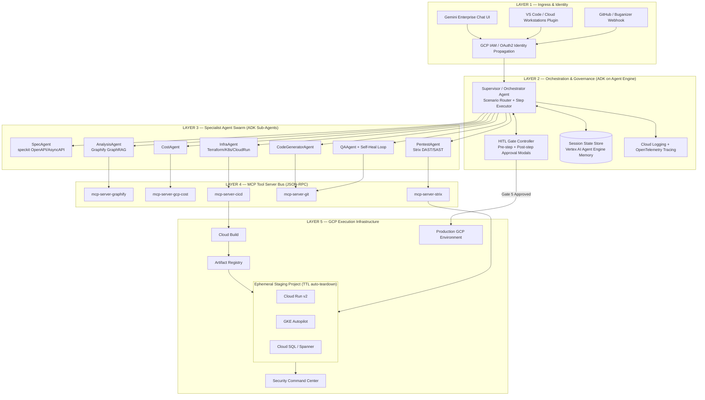

Updated todo list

# High-Level Design (HLD): Autonomous AI DevSecOps Agent

## 1. HLD Architecture Diagram

---

## 2. Layer-by-Layer Technical Breakdown

### Layer 1 — Ingress & Identity

| Component       | Tech                                   | Detail                                                                                                            |
| --------------- | -------------------------------------- | ----------------------------------------------------------------------------------------------------------------- |
| Chat UI         | **Gemini Enterprise**                  | Natural-language entry point, renders approval modals + live stepper                                              |
| IDE integration | VS Code / Cloud Workstations extension | Shows diffs and gate prompts inline                                                                               |
| Ticket trigger  | GitHub/Buganizer webhook listener      | Auto-starts "Ongoing" scenario on new ticket                                                                      |
| Identity        | GCP IAM + OAuth2                       | Every downstream tool call runs under the user's actual IAM permissions (no service-account privilege escalation) |

### Layer 2 — Orchestration & Governance

| Component            | Tech                                   | Detail                                                                                                                |
| -------------------- | -------------------------------------- | --------------------------------------------------------------------------------------------------------------------- |
| Orchestrator         | **Google ADK (Agent Development Kit)** | Single `Supervisor` agent; holds the scenario router + shared step-executor loop                                      |
| Hosting              | **Vertex AI Agent Engine**             | Serverless hosting for the whole agent swarm; manages scaling, session lifecycle                                      |
| State                | Agent Engine Session Store             | Persists conversation + pipeline step state across gate pauses (pipeline can pause for hours/days waiting on a human) |
| HITL Gate Controller | Custom Python module (`hitl_gate.py`)  | Generic `request_approval(step, summary, tools, risk_level)` used identically at all 5 gates                          |
| Observability        | Cloud Logging + OpenTelemetry          | Distributed trace per pipeline run, correlated by `pipeline_id`                                                       |

### Layer 3 — Specialist Agents (all ADK agents, LLM = Gemini 2.5 Pro/Flash)

| Agent                | Model tier | Responsibility                                                                                       |
| -------------------- | ---------- | ---------------------------------------------------------------------------------------------------- |
| `SpecAgent`          | Flash      | Generates OpenAPI/AsyncAPI specs & data models via `speckit` (Greenfield scenario)                   |
| `AnalysisAgent`      | Pro        | Queries Graphify GraphRAG for AST, dependency graphs, call hierarchies (Migration/Ongoing scenarios) |
| `CodeGeneratorAgent` | Pro        | Writes/refactors production code + unit tests, creates git branch + diff                             |
| `CostAgent`          | Flash      | Computes cost estimates & savings % via GCP Billing API                                              |
| `InfraAgent`         | Pro        | Renders Terraform HCL, Cloud Run/GKE manifests, Cloud Build YAML from Jinja2 templates               |
| `QAAgent`            | Pro        | Runs tests, diagnoses failures, generates self-healing patches (loop until 100% pass or max retries) |
| `PentestAgent`       | Pro        | Runs Strix DAST/SAST, produces CVSS-scored audit report                                              |

**Why Pro vs Flash:** reasoning-heavy tasks (code, infra, self-heal, security) use Pro; fast/cheap lookups (pricing math, routing) use Flash.

### Layer 4 — MCP Tool Server Bus

Each tool is wrapped as an independent MCP (Model Context Protocol) server — a decoupled JSON-RPC microservice, containerized, callable by any agent:
| MCP Server | Wraps | Key Tool Exposed |
|---|---|---|
| `mcp-server-graphify` | Graphify GraphRAG | `query_codebase_graph`, `index_repository` |
| `mcp-server-gcp-cost` | GCP Cloud Billing API | `get_gcp_pricing`, `estimate_workload_cost` |
| `mcp-server-cicd` | Cloud Build + Artifact Registry CLI | `trigger_cloud_build`, `push_image`, `deploy_service` |
| `mcp-server-git` | Git | `create_branch`, `commit_diff`, `open_pr` |
| `mcp-server-strix` | Strix scanner | `run_dast_scan`, `run_sast_scan` — **hard guardrail rejects any non-`*.staging.*`/`*-sandbox.*` target** |

**Why MCP:** decouples "what tool does" from "which agent calls it" — any agent can call any tool through one standard protocol, and tools can be swapped/upgraded independently.

### Layer 5 — GCP Execution Infrastructure

| Component          | Tech                                 | Detail                                                                                                                  |
| ------------------ | ------------------------------------ | ----------------------------------------------------------------------------------------------------------------------- |
| CI/CD engine       | **Cloud Build**                      | Builds container, runs SAST/Trivy scan, pushes image                                                                    |
| Image storage      | **Artifact Registry**                | Private, vulnerability-scanned container storage                                                                        |
| Staging compute    | **Cloud Run v2** / **GKE Autopilot** | Chosen per `MigrationPlan` decision matrix; isolated **ephemeral sandbox project** with TTL auto-teardown (e.g., 2 hrs) |
| Data               | Cloud SQL / Spanner                  | Only provisioned if the workload is stateful                                                                            |
| Production         | Separate GCP project                 | Touched **only** after Gate 5 sign-off                                                                                  |
| Security telemetry | **Security Command Center**          | Central log of all Strix findings across runs                                                                           |

---

## 3. Full Technology Stack Summary

| Category                   | Tool / Service                | Vendor                     |
| -------------------------- | ----------------------------- | -------------------------- |
| Agent framework            | Google ADK                    | Google OSS                 |
| Agent hosting              | Vertex AI Agent Engine        | Google Cloud               |
| LLMs                       | Gemini 2.5 Pro & Flash        | Google Vertex AI           |
| UI / Identity / Governance | Gemini Enterprise             | Google Workspace           |
| Codebase GraphRAG          | Graphify                      | OSS                        |
| Spec alignment             | speckit                       | OSS                        |
| Security pentest           | Strix                         | OSS                        |
| Container/code scanning    | Trivy, Bandit                 | OSS                        |
| IaC                        | Terraform (Google provider)   | HashiCorp                  |
| IaC security scan          | Checkov, TFSec                | Bridgecrew/Aqua            |
| CI/CD                      | Cloud Build                   | Google Cloud               |
| Registry                   | Artifact Registry             | Google Cloud               |
| Compute (serverless)       | Cloud Run v2                  | Google Cloud               |
| Compute (k8s)              | GKE Autopilot                 | Google Cloud               |
| Pricing data               | Cloud Billing API             | Google Cloud               |
| Security findings          | Security Command Center       | Google Cloud               |
| Tool protocol              | Model Context Protocol (MCP)  | Anthropic/Linux Foundation |
| Observability              | Cloud Logging + OpenTelemetry | Google Cloud/CNCF          |

---

## 4. Approach — How We'll Actually Build It

1. **Design the shared contract first**: define `Proposal`, `MigrationPlan`, `GateDecision` as fixed Pydantic schemas — every agent reads/writes these, regardless of scenario.
2. **Build the orchestrator + HITL gate engine as pure Python**, no LLM yet — prove the pause/resume/approve mechanic works reliably with Agent Engine's session store.
3. **Build one scenario vertically** (Migration/Cost, since it's fully spec'd already) as plain deterministic functions — validates the full gate chain end-to-end.
4. **Wrap each function behind an MCP server** — same logic, now tool-callable.
5. **Replace deterministic functions with ADK agents** calling those MCP tools via Gemini — adds reasoning on top of working plumbing.
6. **Add the other 2 scenario adapters** (Greenfield, Ongoing) — they only change the Analysis entry step; everything downstream is reused unchanged.
7. **Bolt on security guardrails** (Strix scope restriction, Checkov/TFSec gating, ephemeral sandbox TTL) before ever pointing at a real GCP project.
8. **Deploy to Agent Engine, register in Gemini Enterprise**, wire IAM identity propagation last, once functionality is proven.

This order de-risks the hardest problem (reliable pause/resume HITL orchestration) first, and defers "which LLM/agent framework glue" until the business logic is already correct.
