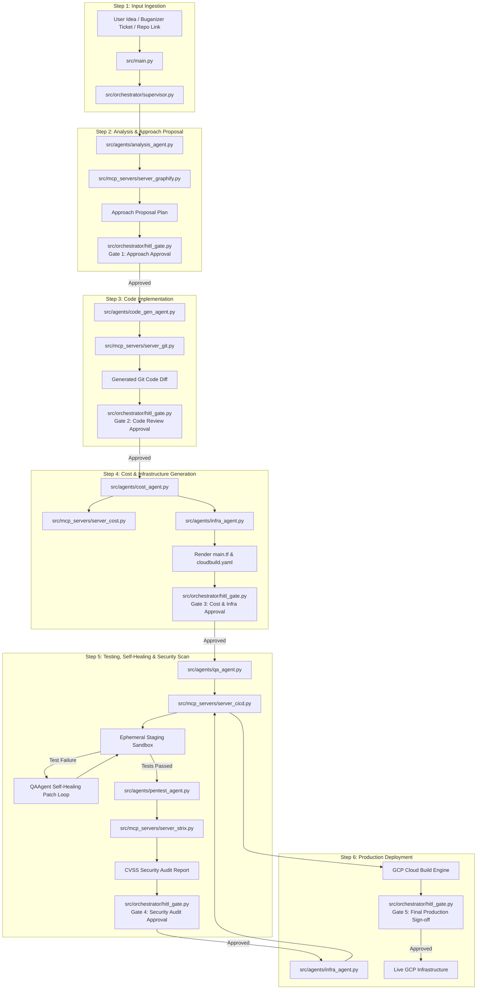

# Full Project Architecture Specification: Autonomous AI DevSecOps Agent

## Executive Summary

This document presents the complete **Project Repository Directory Structure**, **File-by-File Responsibility Mapping**, **End-to-End Data & Control Flow**, and **Services & 3rd Party Tools Integration Matrix** for building the Autonomous AI DevSecOps Agent on Google Cloud.

---

## 1. Project Directory & Folder Structure

```
autonomous-devsecops-agent/
├── README.md                          # Project documentation & quickstart guide
├── pyproject.toml                     # Dependencies & build configuration (Poetry / Hatch)
├── Dockerfile                         # Container spec for running the agent system on Agent Engine
├── .env.example                       # Environment variables template (GCP_PROJECT_ID, GEMINI_API_KEY)
│
├── config/                            # Global System & Agent Configurations
│   ├── agent_config.yaml              # Agent system prompts, model tiers, max retry limits
│   ├── gcp_config.yaml                # Default GCP regions, billing project IDs, staging sandbox settings
│   └── security_rules.yaml            # Pentest URL allowlists, DAST intensity thresholds, forbidden actions
│
├── src/                               # Main Application Source Code
│   ├── __init__.py
│   ├── main.py                        # Service entrypoint (FastAPI / Agent Engine server)
│   │
│   ├── orchestrator/                  # ADK Supervisor & State Management
│   │   ├── __init__.py
│   │   ├── supervisor.py              # Main ADK Supervisor Agent (Routes tasks & manages context)
│   │   ├── state_manager.py           # Vertex Agent Engine session state & conversation history
│   │   └── hitl_gate.py               # Human-in-the-Loop Confirmation Gate Controller
│   │
│   ├── agents/                        # ADK Specialist Sub-Agents
│   │   ├── __init__.py
│   │   ├── spec_agent.py              # Spec Alignment Agent (speckit / OpenAPI parsing)
│   │   ├── analysis_agent.py          # Codebase Analysis Agent (Graphify GraphRAG queries)
│   │   ├── code_gen_agent.py          # E2E App Code Generation & Refactoring Agent
│   │   ├── cost_agent.py              # GCP Cost & Scaling Optimization Agent
│   │   ├── infra_agent.py             # Terraform HCL & Kubernetes/Cloud Run Manifest Generator
│   │   ├── qa_agent.py                # E2E Testing & Log Diagnosis Self-Healing Agent
│   │   └── pentest_agent.py           # Security Vulnerability & Strix Scanner Agent
│   │
│   ├── mcp_servers/                   # Model Context Protocol (MCP) Tool Servers
│   │   ├── __init__.py
│   │   ├── server_graphify.py         # MCP Server: Graphify AST & Codebase GraphRAG
│   │   ├── server_strix.py            # MCP Server: Strix DAST/SAST Scanner Wrapper
│   │   ├── server_cost.py             # MCP Server: GCP Cloud Billing API & Pricing Calculator
│   │   ├── server_cicd.py             # MCP Server: Cloud Build & Artifact Registry CLI Wrapper
│   │   └── server_git.py              # MCP Server: Git workspace repository manager
│   │
│   ├── models/                        # Data Schemas & Pydantic Data Structures
│   │   ├── __init__.py
│   │   ├── checkpoints.py             # Confirmation Gate checkpoint payload schemas
│   │   ├── cost_models.py             # Resource specs and cost comparison objects
│   │   └── security_models.py         # Strix scan result schemas & CVSS audit reports
│   │
│   └── utils/                         # Shared Utilities & Helpers
│       ├── __init__.py
│       ├── gcp_client.py              # GCP API authentication & client initialization
│       ├── logging.py                 # OpenTelemetry & GCP Cloud Logging setup
│       └── template_engine.py         # Jinja2 renderer for Terraform HCL & Cloud Build YAML
│
├── templates/                         # Code & Infrastructure Templates
│   ├── terraform/                     # Base Terraform HCL modules
│   │   ├── cloud_run.tf.j2            # Cloud Run v2 service template
│   │   └── gke_autopilot.tf.j2        # GKE Autopilot cluster template
│   └── cicd/                          # CI/CD pipeline templates
│       ├── cloudbuild.yaml.j2         # GCP Cloud Build pipeline template
│       └── github_actions.yaml.j2     # GitHub Actions workflow template
│
└── tests/                             # Unit, Integration & E2E Test Suites
    ├── unit/                          # Unit tests for agents & MCP tools
    ├── integration/                   # Integration tests with GCP mock services
    └── e2e/                           # Full pipeline end-to-end integration tests
```

---

## 2. File-by-File Responsibility Mapping

| File Path | Role & Primary Responsibility | Key Functions / Classes |
| :--- | :--- | :--- |
| `src/main.py` | Application entrypoint; exposes REST/gRPC endpoints for Gemini Enterprise UI & webhooks. | `app = FastAPI()`, `run_agent_session()` |
| `src/orchestrator/supervisor.py` | Primary ADK Supervisor Agent; evaluates intent, routes tasks across 7 specialist sub-agents. | `class DevSecOpsSupervisor(OrchestratorAgent)` |
| `src/orchestrator/state_manager.py` | Manages conversation memory, session checkpoints, and state persistence on Vertex AI Agent Engine. | `class SessionStateManager` |
| `src/orchestrator/hitl_gate.py` | Enforces the 5 interactive User Confirmation Gates; halts execution until human approval is received. | `class HITLGateController`, `request_gate_approval()` |
| `src/agents/spec_agent.py` | Formulates OpenAPI/Proto API definitions and data models from user concepts via `speckit`. | `class SpecAgent`, `generate_api_spec()` |
| `src/agents/analysis_agent.py` | Queries Graphify GraphRAG to read codebase structure, call graphs, AST, and dependencies. | `class AnalysisAgent`, `analyze_impact()` |
| `src/agents/code_gen_agent.py` | Generates full app codebases (Greenfield) or refactors existing files (Ongoing Tasks/Migration). | `class CodeGeneratorAgent`, `refactor_module()` |
| `src/agents/cost_agent.py` | Estimates baseline vs target GCP resource costs ($) and calculates scaling limits. | `class CostScalingAgent`, `compute_cost_savings()` |
| `src/agents/infra_agent.py` | Generates production-ready Terraform HCL (`main.tf`) and Cloud Run/GKE YAML manifests. | `class InfraBuilderAgent`, `render_terraform()` |
| `src/agents/qa_agent.py` | Executes unit/E2E tests in sandboxes; diagnoses logs and auto-applies self-healing fix patches. | `class QAAgent`, `self_heal_test_failure()` |
| `src/agents/pentest_agent.py` | Invokes Strix DAST/SAST security scanner against staging targets and generates CVSS audit reports. | `class PentestAgent`, `run_security_audit()` |
| `src/mcp_servers/server_graphify.py` | MCP tool server exposing codebase AST graph search (`mcp_graphify_query`). | `server = Server("graphify-mcp")` |
| `src/mcp_servers/server_strix.py` | MCP tool server wrapping Strix security scanner CLI (`run_strix_dast_scan`). | `server = Server("strix-mcp")` |
| `src/mcp_servers/server_cost.py` | MCP tool server wrapping GCP Billing & Pricing API (`get_gcp_pricing`). | `server = Server("gcp-cost-mcp")` |
| `src/mcp_servers/server_cicd.py` | MCP tool server wrapping Cloud Build & Artifact Registry (`trigger_cloud_build`). | `server = Server("cicd-mcp")` |

---

## 3. End-to-End Project Data & Control Flow



---

## 4. Google Cloud Services, Open Source Libraries & 3rd Party Integrations Matrix

| Component Category | Technology / Service | Source / Vendor | Purpose in System |
| :--- | :--- | :--- | :--- |
| **Agent Framework** | **Google Gen AI ADK** | Google Open Source | Multi-agent orchestration, supervisor routing, tool bindings. |
| **Agent Host & State** | **Vertex AI Agent Engine** | Google Cloud Native | Serverless agent hosting, managed state persistence, session history. |
| **Foundation LLMs** | **Gemini 2.5 Pro & Flash** | Google Vertex AI | Code reasoning (Pro), cost calculations & rapid routing (Flash). |
| **Governance & UI** | **Gemini Enterprise** | Google Workspace | Developer chat UI, OAuth2 identity, interactive confirmation modals. |
| **Codebase GraphRAG**| **Graphify** | Open Source / Google | Parses codebase AST, generates dependency graphs and indexing. |
| **Spec Alignment** | **`speckit`** | Open Source | Validates and generates OpenAPI, AsyncAPI, and Proto specs. |
| **Security Pentesting**| **Strix** | Open Source / Security Tool | SAST code scanning & DAST web vulnerability pentesting. |
| **Container Scanner** | **Trivy / Bandit** | Open Source | Container image vulnerability and Python SAST linting. |
| **Infra-as-Code (IaC)**| **Terraform (Google Provider)**| HashiCorp | Programmatic provisioning of Cloud Run, GKE, and Cloud SQL. |
| **IaC Security Scanner**| **Checkov / TFSec** | Bridgecrew / Aqua Security | Pre-commit static security analysis on generated `main.tf`. |
| **CI/CD Build Engine** | **Google Cloud Build** | Google Cloud Native | Container building, test execution, and deployment orchestration. |
| **Container Registry** | **Artifact Registry** | Google Cloud Native | Secure storage for build Docker images. |
| **Serverless Compute** | **Cloud Run v2** | Google Cloud Native | Scalable, cost-effective hosting for web microservices. |
| **Kubernetes Compute** | **GKE Autopilot** | Google Cloud Native | Managed Kubernetes hosting for complex container mesh workloads. |
| **Cost Pricing Data** | **GCP Cloud Billing API** | Google Cloud Native | Live SKU pricing queries for exact cost estimation. |
| **Security Telemetry** | **Security Command Center**| Google Cloud Native | Centralized security findings and vulnerability logging. |
| **Tool Protocol Standard**| **Model Context Protocol (MCP)**| Anthropic / Linux Foundation | Standard JSON-RPC protocol exposing tools to agents. |
