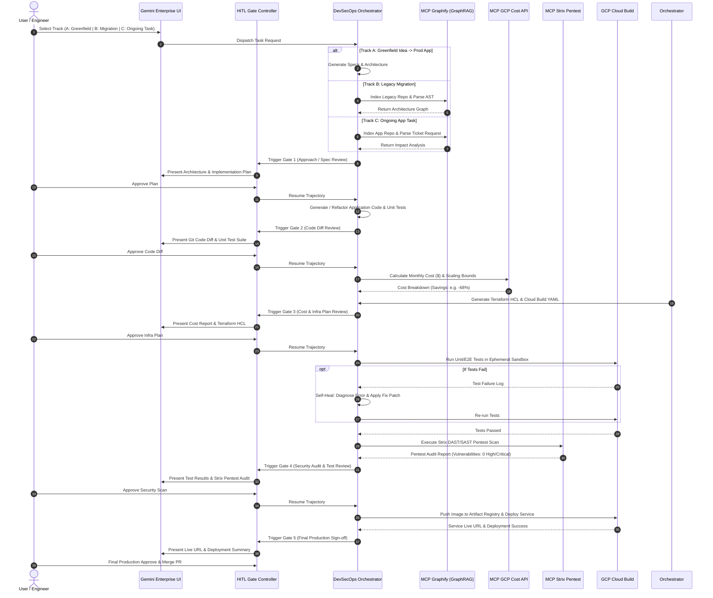

# In-Depth High-Level Design (HLD): Autonomous AI DevSecOps Agent on Google Cloud

## Executive Summary

This High-Level Design (HLD) document details the complete end-to-end architecture, sub-agent communication protocols, Model Context Protocol (MCP) tool bindings, security sandboxing, and interactive **Human-in-the-Loop (HITL)** governance checkpoints required to achieve an enterprise-grade **Autonomous AI DevSecOps System on Google Cloud**.

---

## 1. High-Level Design (HLD) System Architecture Diagram

```mermaid
flowchart TB
    subgraph IngressLayer["1. Ingress & Developer Interfaces"]
        UI[Gemini Enterprise Workspace UI]
        IDE[VS Code / Cloud Workstations Plugin]
        Webhook[GitHub / Buganizer Webhook Listener]
        CLI[DevSecOps CLI Tool]
    end

    subgraph GovernanceLayer["2. Identity & Human-in-the-Loop (HITL) Gate Controller"]
        IAM[GCP IAM / OAuth2 Identity Propagation]
        GateManager[HITL Gate Controller Engine]
        ModalUI[Interactive Approval Modal & Diff Viewer]
        GateManager <--> ModalUI
    end

    subgraph RuntimeEngine["3. Vertex AI Agent Engine (Runtime & State Store)"]
        SessionStore[(Agent Session State & Memory Store)]
        TraceLogs[Cloud Logging & OpenTelemetry Distributed Tracing]
        
        subgraph ADKSwarm["ADK Multi-Agent Orchestrator Swarm"]
            Supervisor[DevSecOps Router & Orchestrator Agent]

            subgraph Specialists["Specialist Sub-Agents"]
                SpecAgent["Spec & Alignment Agent\n(speckit)"]
                GraphifyAgent["Code Analysis Agent\n(Graphify GraphRAG)"]
                CodeAgent["Code Generator & Refactor Agent"]
                CostAgent["Cost & Scale Optimization Agent\n(GCP Billing API)"]
                InfraAgent["IaC & Pipeline Builder Agent\n(Terraform HCL)"]
                QAAgent["QA & Self-Healing Agent\n(PyTest / Log Diagnosis)"]
                PentestAgent["Pentesting Security Agent\n(Strix DAST/SAST)"]
            end
        end
    end

    subgraph MCPBus["4. Model Context Protocol (MCP) Tool Server Bus"]
        MCP_Graphify["MCP Server: Graphify Codebase GraphRAG"]
        MCP_Strix["MCP Server: Strix Pentest Suite"]
        MCP_Cost["MCP Server: GCP Billing & Pricing API"]
        MCP_CICD["MCP Server: Cloud Build & Artifact Registry"]
        MCP_Git["MCP Server: Git & Repository Manager"]
    end

    subgraph GCPInfra["5. Google Cloud Target Execution Infrastructure"]
        CloudBuild[Cloud Build / Workflows Engine]
        ArtifactReg[Artifact Registry\n(Docker Containers)]
        
        subgraph SandboxProject["Ephemeral Staging Project (Isolated Sandbox)"]
            CloudRun[Cloud Run v2 Services]
            GKEAutopilot[GKE Autopilot Clusters]
            CloudSQL[Cloud SQL / Spanner DB]
        end
        
        ProdEnv[Production Google Cloud Environment]
        SCC[Security Command Center]
    end

    %% Ingress Connections
    UI --> IAM
    IDE --> IAM
    Webhook --> IAM
    CLI --> IAM
    IAM --> Supervisor

    %% Orchestrator & Governance
    Supervisor <--> GateManager
    Supervisor <--> SessionStore
    Supervisor --> TraceLogs

    %% Orchestrator Sub-Agent Delegation
    Supervisor --> SpecAgent
    Supervisor --> GraphifyAgent
    Supervisor --> CodeAgent
    Supervisor --> CostAgent
    Supervisor --> InfraAgent
    Supervisor --> QAAgent
    Supervisor --> PentestAgent

    %% Specialist Agent to MCP Server Bindings
    GraphifyAgent --> MCP_Graphify
    CodeAgent --> MCP_Git
    CostAgent --> MCP_Cost
    InfraAgent --> MCP_CICD
    QAAgent --> MCP_Git
    PentestAgent --> MCP_Strix
    
    %% MCP to GCP Infrastructure Execution
    MCP_CICD --> CloudBuild
    CloudBuild --> ArtifactReg
    CloudBuild --> SandboxProject
    MCP_Strix --> SandboxProject
    SandboxProject --> SCC
    
    %% Production Deployment Gate Flow
    GateManager -->|User Approval Gate 5| ProdEnv
```

---

## 2. Comprehensive Layer Breakdown

### Layer 1: Ingress & Interface Layer
- **Gemini Enterprise Workspace UI**: Natural language workspace interface for triggering tracks, reviewing plans, and approving gates.
- **Webhook Listener**: Listens to Buganizer tickets (`b/12345`) or GitHub Issues to automatically trigger **Track C (Ongoing App Feature/Bugfix)**.
- **IDE Extensions**: In-editor sidebar showing live agent execution, diffs, and confirmation prompts.

### Layer 2: Governance & HITL Approval Controller
- **OAuth2 / IAM Token Propagation**: Ensures every agent tool call operates strictly under the user's authorized IAM permissions.
- **Interactive Gate Controller**: Pauses agent trajectory at critical checkpoints:
  - `Gate 1`: Architecture & Spec Approval.
  - `Gate 2`: Generated/Refactored Code Diff Approval.
  - `Gate 3`: Cost Estimation & Terraform HCL Plan Approval.
  - `Gate 4`: Test Status & Strix Pentest CVSS Audit Approval.
  - `Gate 5`: Production Release Sign-off.

### Layer 3: Vertex AI Agent Engine & ADK Swarm
- **Supervisor / Orchestrator Agent**: State machine evaluating user intent, routing to specialist sub-agents, and enforcing step-by-step gate reviews.
- **Specialist Agent Swarm**:
  - `SpecAgent`: Formulates OpenAPI specs, AsyncAPI definitions, and data models via `speckit`.
  - `GraphifyAgent`: Queries `mcp-server-graphify` to read code structure, AST, function dependency graphs, and architecture docs.
  - `CodeAgent`: Writes production-grade Go, Python, TypeScript, or Java code, including unit test suites.
  - `CostAgent`: Analyzes SKU rates via `mcp-server-gcp-cost`, evaluates scaling characteristics, and calculates monthly cost reduction ($ and %).
  - `InfraAgent`: Auto-generates Terraform `main.tf`, Cloud Run `service.yaml`, and Cloud Build `cloudbuild.yaml`.
  - `QAAgent`: Executes unit/E2E test suites inside Cloud Build. Captures error stack traces, auto-diagnoses bugs, and applies self-healing code patches.
  - `PentestAgent`: Invokes `mcp-server-strix` to execute DAST/SAST scans against staging targets.

### Layer 4: MCP Tool Server Bus (JSON-RPC)
- Modular, decoupled microservices wrapping internal tools behind standardized MCP interfaces.
- **Containers**: Packaged as lightweight Docker containers running on Cloud Run or local stdio/HTTP sockets.

### Layer 5: Target GCP Infrastructure & Sandboxing
- **Ephemeral Staging Project**: Every application build or pentest scan runs in an isolated sandbox GCP project with an auto-teardown TTL (e.g. 2 hours) to ensure zero risk to production.

---

## 3. End-to-End Sequence Diagram for All 3 Tracks



---

## 4. Security, Isolation & Guardrails Protocol

1. **Strict Target Sandbox Scoping**:
   - Dynamic pentesting via Strix is restricted **exclusively** to staging environments matching `*.staging.cloudrun.app` or `*-sandbox.internal`.
   - Any request targeting `prod` or external IPs is automatically blocked by the MCP Strix Server guardrail.
2. **Infrastructure-as-Code (IaC) Scanning**:
   - All auto-generated Terraform HCL passes through `checkov` and `tfsec` static analysis before presentation at Gate 3.
3. **Identity & Least Privilege**:
   - Agents interact with GCP APIs using Service Accounts configured with minimal Workload Identity bindings.
4. **Deterministic Patch Verification**:
   - The `QAAgent` cannot present a self-healed patch to the user unless 100% of the unit test suite passes.
