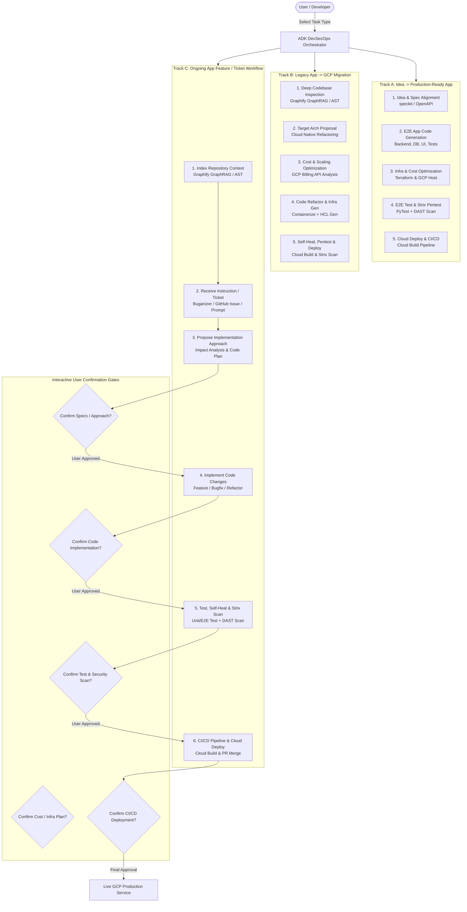
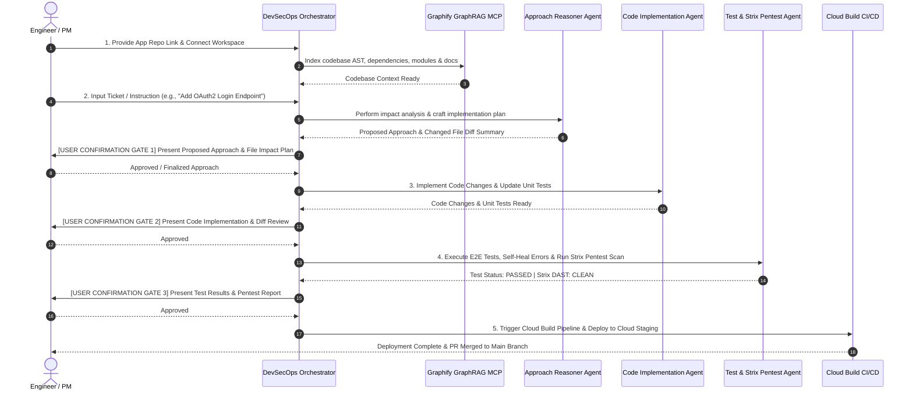

# Master Solution Blueprint: Autonomous AI DevSecOps Agent on Google Cloud

## Executive Summary

This master blueprint defines the 3 core operational tracks of the **Autonomous AI DevSecOps Agent on Google Cloud**:

1. **Track A (Greenfield)**: **Idea $\rightarrow$ Production-Ready App**
2. **Track B (Brownfield Migration)**: **Legacy App $\rightarrow$ Google Cloud Migration**
3. **Track C (Ongoing App Lifecycle)**: **Repo Indexing $\rightarrow$ Instruction / Ticket $\rightarrow$ Approach Proposal $\rightarrow$ Implementation $\rightarrow$ Test $\rightarrow$ CI/CD Deployment**

---

## 1. Complete Multi-Track System Topology

---

## 2. Track C Deep-Dive: Ongoing App Maintenance & Ticket Workflow

### Sequence Breakdown (Repo $\rightarrow$ Ticket $\rightarrow$ Approach $\rightarrow$ Implement $\rightarrow$ CI/CD)

---

## 3. Detailed Component Breakdown for Track C

### Step 1: Repository Context Indexing
- **Tool**: `mcp-server-graphify`
- **Function**: Scans repository files, builds AST (Abstract Syntax Tree), maps function call hierarchy, imported libraries, environment configurations, and existing CI/CD pipelines.

### Step 2: Ticket / Instruction Processing & Approach Proposal
- **Input**: Natural language prompts, Buganizer issue links (`b/123456`), or GitHub Issues.
- **Agent**: `AnalysisAgent` + `ReasonerAgent`.
- **Output**: Structured Implementation Proposal:
  1. High-level approach description.
  2. Exact list of files to add/modify (`app/api/auth.go`, `config/env.yaml`, `tests/auth_test.go`).
  3. Security considerations & potential dependency impacts.
- **User Gate**: User reviews the proposed approach and can request adjustments before a single line of code is written.

### Step 3: Code Implementation & Refactoring
- **Agent**: `CodeGeneratorAgent` / `SelfHealAgent`.
- **Function**: Writes modular, standard-compliant code, updates unit test suites, and updates database schemas or API definitions.
- **User Gate**: User reviews git diff of generated changes.

### Step 4: Testing, Self-Healing & Pentesting
- **Agents**: `TestAgent` + `PentestAgent` (wrapping Strix DAST/SAST).
- **Function**:
  1. Runs unit & integration test suites.
  2. If tests fail, `SelfHealAgent` diagnoses the error log and generates a fix diff.
  3. Runs Strix security scanner on staging container to verify zero vulnerabilities.
- **User Gate**: User inspects test coverage report and Strix CVSS security audit.

### Step 5: CI/CD Pipeline Execution & Cloud Deployment
- **Tools**: `Cloud Build` / `GitHub Actions` / `Artifact Registry` via `mcp-server-cicd`.
- **Function**: Triggers container build, pushes image, applies Terraform infrastructure updates (if needed), and deploys service to Google Cloud (Cloud Run / GKE).

---

## 4. Master Capabilities Comparison Across All 3 Tracks

| Lifecycle Stage | Track A: Greenfield (Idea $\rightarrow$ App) | Track B: Migration (Old $\rightarrow$ GCP) | Track C: Ongoing App (Ticket $\rightarrow$ Deploy) |
| :--- | :--- | :--- | :--- |
| **Initial Input** | Text prompt / Idea concept | Legacy repo link & arch docs | Ongoing App repo link + Ticket / Instruction |
| **Codebase Context** | N/A (Creates fresh repo) | Graphify AST & dependency analysis | Incremental Graphify AST indexing |
| **Design Phase** | Generates OpenAPI / database specs | Recommends GCP target architecture | Generates Feature Implementation Approach Plan |
| **User Confirmation 1** | Approve Specs & Arch | Approve Migration Plan & Arch | **Approve Proposed Feature Approach** |
| **Code Generation** | Full app codebase & unit tests | Refactored code & containerization | Modifies target files & updates tests |
| **User Confirmation 2** | Approve Full Codebase | Approve Refactored Code | **Approve Code Diff** |
| **Infra & Cost Opt** | Estimates pricing, builds Terraform | Estimates pricing diff, builds Terraform | Updates existing Terraform HCL if required |
| **Testing & Pentesting**| PyTest / E2E + Strix DAST Scan | PyTest / E2E + Strix DAST Scan | Unit/Integration Tests + Strix DAST Scan |
| **User Confirmation 3** | Approve Pentest Report | Approve Pentest Report | **Approve Test & Security Audit** |
| **CI/CD Deployment** | Cloud Build pipeline & deploy | Cloud Build pipeline & deploy | Triggers Cloud Build & Merges PR |
