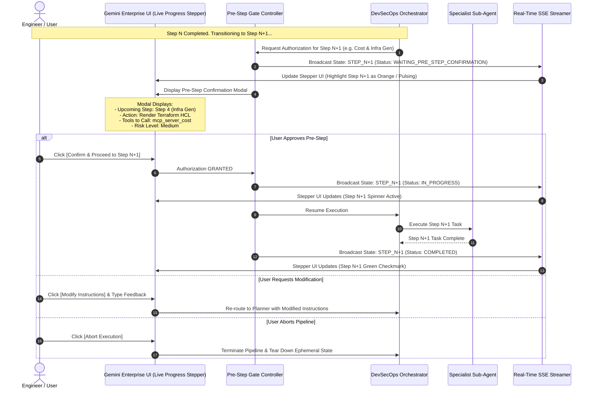

# UI Real-Time Progress Tracker & Pre-Step Confirmation Gate Specification

## Executive Summary

This specification defines the real-time **Progress Tracking UI Widget** and **Pre-Step Confirmation Protocol** for the Autonomous AI DevSecOps Agent. 

With this system, the user has total visibility and control:
1. **Real-Time Progress UI Tracker**: An interactive stepper widget embedded in Gemini Enterprise UI showing active step status (`COMPLETED`, `IN_PROGRESS`, `WAITING_USER`, `PENDING`), elapsed time, active sub-agent, and streaming execution logs.
2. **Pre-Step Confirmation Gates**: Before initiating **ANY** phase, the system pauses and displays a **Pre-Step Approval Modal** describing what the upcoming step will do, which tools/APIs will be invoked, estimated duration, and risk level.

---

## 1. Real-Time UI Progress Stepper Widget Design

```
+-------------------------------------------------------------------------------------------------+
|  AUTONOMOUS DEVSECOPS AGENT -- LIVE PIPELINE TRACKER                                            |
+-------------------------------------------------------------------------------------------------+
|  [✓] Step 1: Codebase Analysis & GraphRAG Indexing                       (Done - 12s)           |
|  [✓] Step 2: Architecture & Approach Proposal                            (Done - 8s)            |
|  [▶] Step 3: Application Code Generation & Refactoring                   (IN PROGRESS... 24s)   |
|      ├── Sub-Agent: CodeGeneratorAgent                                                          |
|      ├── Active Tool: mcp_server_git.create_branch("feature/oauth2-login")                      |
|      └── Live Logs: Parsing AST... Generated app/api/auth.go... Writing unit tests...          |
|  [ ] Step 4: Cost & Infrastructure Optimization                          (Pending)              |
|  [ ] Step 5: E2E Testing, Self-Healing & Strix Pentest                   (Pending)              |
|  [ ] Step 6: Cloud Build CI/CD & GCP Deployment                          (Pending)              |
+-------------------------------------------------------------------------------------------------+
|  STATUS: WAITING FOR PRE-STEP CONFIRMATION FOR STEP 4                                            |
|  [ Confirm & Proceed to Step 4 ]    [ Request Modification ]    [ Abort Pipeline ]             |
+-------------------------------------------------------------------------------------------------+
```

---

## 2. Pre-Step Confirmation Gate Sequence Architecture



---

## 3. Pre-Step Modal Payload Schema

Before each step starts, the system generates a standardized JSON payload for the UI modal:

```json
{
  "event_type": "PRE_STEP_CONFIRMATION_REQUIRED",
  "pipeline_id": "pipe-devsecops-9842",
  "step_number": 4,
  "total_steps": 6,
  "step_name": "Cost Assessment & Infrastructure Generation",
  "sub_agent": "InfraBuilderAgent",
  "preview_summary": "This step will calculate GCP billing rates for Cloud Run vs GKE Autopilot and render Terraform HCL (main.tf) and Cloud Build pipeline specs.",
  "tools_to_invoke": [
    "mcp_server_cost.get_gcp_pricing",
    "infra_agent.render_terraform_template"
  ],
  "estimated_duration_seconds": 15,
  "risk_level": "LOW_READ_ONLY_ESTIMATION",
  "user_options": [
    { "action": "APPROVE", "label": "Confirm & Proceed to Step 4" },
    { "action": "MODIFY", "label": "Modify Step Instructions" },
    { "action": "ABORT", "label": "Abort Pipeline" }
  ]
}
```

---

## 4. Implementation Code Stubs

### 4.1 Real-Time State Streamer (`progress_tracker.py`)

```python
"""Real-time Progress Tracker & SSE Event Streamer for UI Stepper."""
import json
import asyncio
from enum import Enum
from dataclasses import dataclass, asdict
from typing import List, Dict, Any

class StepStatus(Enum):
    PENDING = "PENDING"
    WAITING_PRE_STEP_CONFIRMATION = "WAITING_PRE_STEP_CONFIRMATION"
    IN_PROGRESS = "IN_PROGRESS"
    WAITING_POST_STEP_REVIEW = "WAITING_POST_STEP_REVIEW"
    COMPLETED = "COMPLETED"
    FAILED = "FAILED"

@dataclass
class PipelineStepState:
    step_id: int
    name: str
    sub_agent: str
    status: StepStatus
    elapsed_seconds: float = 0.0
    active_tool: str = ""
    logs: List[str] = None

class ProgressTrackerEngine:
    def __init__(self, pipeline_id: str, steps: List[str]):
        self.pipeline_id = pipeline_id
        self.steps = [
            PipelineStepState(
                step_id=i + 1,
                name=name,
                sub_agent="",
                status=StepStatus.PENDING,
                logs=[]
            ) for i, name in enumerate(steps)
        ]

    def update_step_status(self, step_id: int, status: StepStatus, sub_agent: str = "", tool: str = "", log_msg: str = ""):
        """Updates step state and streams real-time update to UI via Server-Sent Events."""
        step = self.steps[step_id - 1]
        step.status = status
        if sub_agent:
            step.sub_agent = sub_agent
        if tool:
            step.active_tool = tool
        if log_msg:
            step.logs.append(log_msg)
            
        self._broadcast_sse_event(step)

    def _broadcast_sse_event(self, active_step: PipelineStepState):
        """Serializes pipeline progress state for UI Stepper streaming."""
        payload = {
            "pipeline_id": self.pipeline_id,
            "active_step_id": active_step.step_id,
            "pipeline_progress_pct": round((sum(1 for s in self.steps if s.status == StepStatus.COMPLETED) / len(self.steps)) * 100, 1),
            "steps": [
                {
                    "step_id": s.step_id,
                    "name": s.name,
                    "sub_agent": s.sub_agent,
                    "status": s.status.value,
                    "active_tool": s.active_tool,
                    "latest_log": s.logs[-1] if s.logs else ""
                } for s in self.steps
            ]
        }
        # Output SSE JSON payload for WebSocket / Server-Sent Events stream
        print(f"[SSE STREAM -> UI] {json.dumps(payload)}")
```

---

### 4.2 Pre-Step Gate Controller (`pre_step_gate.py`)

```python
"""Pre-Step Confirmation Gate Controller."""
import time
from progress_tracker import ProgressTrackerEngine, StepStatus

class PreStepGateController:
    """Enforces explicit user confirmation BEFORE executing any step."""

    def __init__(self, tracker: ProgressTrackerEngine):
        self.tracker = tracker

    def request_pre_step_approval(self, step_id: int, step_name: str, preview_summary: str, tools: list) -> bool:
        """Pauses execution and displays pre-step modal to user."""
        
        # 1. Update UI Stepper state to WAITING_PRE_STEP_CONFIRMATION
        self.tracker.update_step_status(
            step_id=step_id,
            status=StepStatus.WAITING_PRE_STEP_CONFIRMATION,
            log_msg=f"Awaiting user pre-step confirmation to begin '{step_name}'..."
        )

        # 2. Print Modal payload for user interface
        print(f"\n=======================================================")
        print(f"  PRE-STEP CONFIRMATION REQUIRED BEFORE STEP {step_id}: {step_name}")
        print("=======================================================")
        print(f"Summary of Action: {preview_summary}")
        print(f"Tools to be Invoked: {', '.join(tools)}")
        print("\n--> PROMPT TO USER: Do you authorize beginning this step? [Y/n]")

        # In production Gemini Enterprise UI, this blocks on a REST/WebSocket callback.
        user_response = input("User Selection [Y/n]: ").strip().lower()
        
        if user_response in ["y", "yes", ""]:
            self.tracker.update_step_status(
                step_id=step_id,
                status=StepStatus.IN_PROGRESS,
                log_msg=f"Pre-step authorization granted. Starting {step_name}..."
            )
            return True
        else:
            self.tracker.update_step_status(
                step_id=step_id,
                status=StepStatus.FAILED,
                log_msg=f"Pre-step authorization DENIED by user. Pipeline halted."
            )
            return False
```

---

## 5. Summary of UI Progress & Confirmation Touchpoints

| Pipeline Step | Pre-Step Modal Action (Before Step) | Real-Time UI Stepper Display | Post-Step Output Gate (After Step) |
| :--- | :--- | :--- | :--- |
| **Step 1: Codebase Indexing** | Confirm parsing repository files & AST | `[▶] Step 1: Indexing AST (Graphify)...` | View Indexing Summary |
| **Step 2: Approach Proposal** | Confirm generating implementation strategy | `[▶] Step 2: Crafting Plan...` | **Approve / Modify Approach** |
| **Step 3: Code Generation** | Confirm starting code changes & git branch | `[▶] Step 3: Writing app/api/auth.go...` | **Approve Git Code Diff** |
| **Step 4: Cost & Infra Gen** | Confirm querying GCP Billing & rendering Terraform | `[▶] Step 4: Estimating Cloud Costs...` | **Approve Terraform HCL & Cost Report** |
| **Step 5: Test & Pentest** | Confirm spawning sandbox container & Strix DAST | `[▶] Step 5: Running Strix DAST Scan...` | **Approve Pentest CVSS Audit** |
| **Step 6: Cloud Deploy** | Confirm building image & deploying to Cloud Run | `[▶] Step 6: Cloud Build Executing...` | **Final Production Release Sign-off** |
