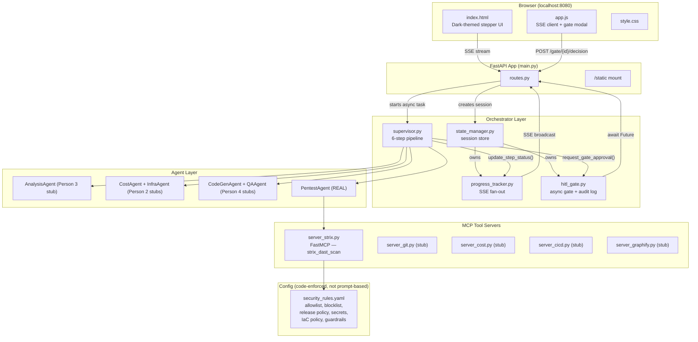
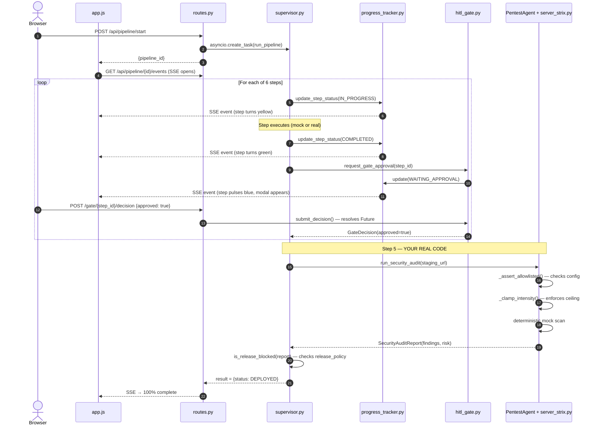
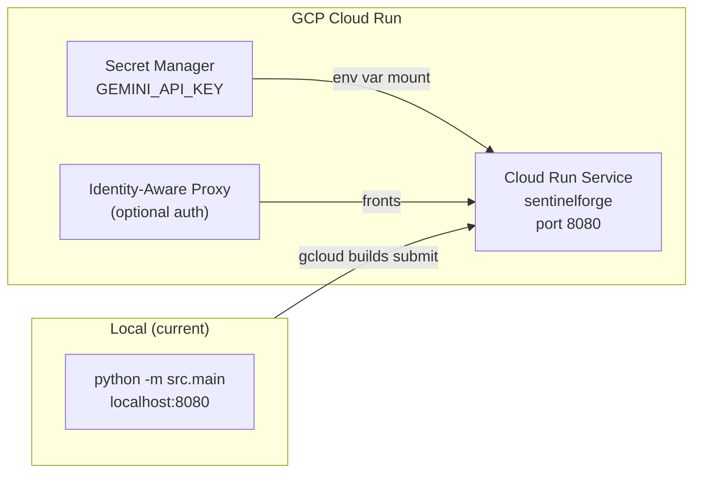
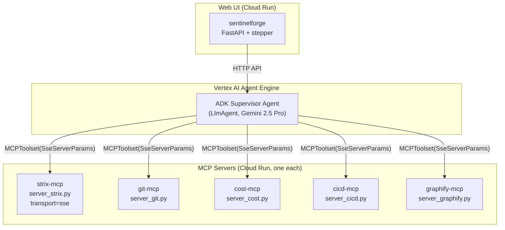
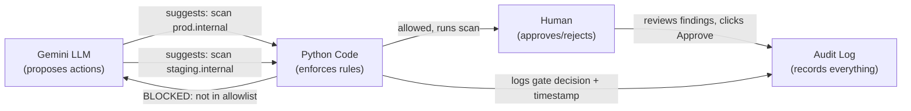

# Person 5 Implementation — Security/Pentest + MCP + UI/Integration

## What Was Built

Person 5 owns three areas: the **Security/Pentest agent + MCP server**, the **Web UI with live stepper + HITL gates**, and the **integration plumbing** (progress tracker, state manager, shared schemas) that every teammate's code plugs into.

---

## Architecture Overview



---

## Pipeline Flow — What Happens When You Click "Run Demo"



---

## File-by-File Reference

### Person 5 Owned Files

| File | What It Does |
|---|---|
| `src/agents/pentest_agent.py` | `PentestAgent` class: `run_security_audit()` → calls MCP server, converts raw findings to `SecurityAuditReport` with CVSS severity. `is_release_blocked()` reads `release_policy` from config. `scan_for_secrets()` checks text against 5 regex patterns (AWS/GCP keys, GitHub PATs, private keys, passwords). |
| `src/mcp_servers/server_strix.py` | Real `FastMCP` server exposing `strix_dast_scan` tool. Enforces `blocked_hosts` first (priority), then `allowlisted_hosts`, then intensity ceiling. Deterministic mock findings (same URL → same results). Runnable standalone: `python -m src.mcp_servers.server_strix`. |
| `src/web/routes.py` | FastAPI router: `GET /` (stepper page), `POST /api/pipeline/start`, `GET /api/pipeline/{id}/events` (SSE), `GET /api/pipeline/{id}/state`, `POST /api/pipeline/{id}/gate/{step}/decision`, `GET /api/pipeline/{id}/audit` (compliance trail). |
| `src/web/templates/index.html` | Dark-themed stepper with 6 steps, progress bar, gate modal (Approve/Reject buttons). |
| `src/web/static/style.css` | Full CSS for the dark theme UI. |
| `src/web/static/app.js` | SSE client, real-time step rendering, gate modal logic, pipeline start. |
| `src/orchestrator/progress_tracker.py` | `ProgressTrackerEngine`: in-memory step state per pipeline run, SSE fan-out to all subscribers (browser tabs). Any call to `update_step_status()` instantly pushes to every connected browser. |
| `src/orchestrator/hitl_gate.py` | `HITLGateController`: `request_gate_approval()` blocks on an `asyncio.Future` until the UI calls `submit_decision()`. Auto-rejects after 1-hour timeout. Full `GateAuditEntry` trail with timestamps. |
| `src/orchestrator/state_manager.py` | `SessionStateManager`: creates a `PipelineSession` per run (owns tracker + gate). In-memory dict — swap for Agent Engine session API on GCP. |
| `src/models/schemas.py` | Shared Pydantic models: `WorkloadSpec`, `CostEstimate`, `MigrationPlan`, `CodeDiff`, `InfraArtifacts`, `AuditReport`, `GateDecision`, `StepStatus`, `PipelineStepView`, etc. |
| `config/security_rules.yaml` | Enterprise security policy: allowlist/blocklist, DAST limits, 8 forbidden actions, release policy, 5 secret patterns, IaC policy (blocks `allUsers`/`0.0.0.0/0`), agent guardrails (retry caps, sandbox TTL). |
| `src/main.py` | FastAPI app, mounts routes + static files, uvicorn entrypoint. |
| `pyproject.toml` | Added `jinja2`, `pyyaml`, `mcp <2` dependencies. |

### Person 5 Modified (scaffolding for integration)

| File | What Changed |
|---|---|
| `src/orchestrator/supervisor.py` | Wired the full 6-step / 5-gate pipeline. Steps 1-4 and 6 are **mock stubs** (clearly commented `# MOCK: replace with ...`). Step 5 pentest is real. |

---

## How Teammates Plug In Their Code

### The pattern is identical for everyone:

Each mock in `supervisor.py` looks like this:

```python
async def _step_propose(self, workload, analysis):
    self.tracker.update_step_status(2, StepStatus.IN_PROGRESS, sub_agent="CostScalingAgent")
    await asyncio.sleep(0.4)  # MOCK: replace with CostScalingAgent.compute_cost_savings() (Person 2)
    # ... hardcoded fake data ...
    return plan
```

To swap in real logic, replace the `asyncio.sleep()` + hardcoded data with your real agent call:

```python
async def _step_propose(self, workload, analysis):
    self.tracker.update_step_status(2, StepStatus.IN_PROGRESS, sub_agent="CostScalingAgent")
    plan = self.cost_agent.compute_cost_savings(workload)  # YOUR REAL CODE
    self.tracker.update_step_status(2, StepStatus.COMPLETED, log_msg=f"Savings: {plan.savings_pct}%")
    return plan
```

**No other file needs to change.** The gate, tracker, SSE, and UI work automatically.

### Swap points per teammate:

| Teammate | Method in `supervisor.py` | Mock Comment to Find | What to Return |
|---|---|---|---|
| **Person 3** | `_step_analyze()` | `# MOCK: replace with AnalysisAgent.analyze_impact() (Person 3)` | `dict` with `detected_platform`, `summary` |
| **Person 2** | `_step_propose()` | `# MOCK: replace with CostScalingAgent.compute_cost_savings() (Person 2)` | `MigrationPlan` (from `schemas.py`) |
| **Person 4** | `_step_codegen()` | `# MOCK: replace with CodeGeneratorAgent.refactor_module() (Person 4)` | `CodeDiff` (from `schemas.py`) |
| **Person 2** | `_step_cost_infra()` | `# MOCK: replace with InfraBuilderAgent.render_terraform() (Person 2)` | `dict` with `validation_passed`, `validation_findings` |
| **Person 4** | `_step_test_and_pentest()` (first half) | `# MOCK: replace with QAAgent.self_heal_test_failure() (Person 4)` | Test pass/fail logs |
| **Person 2/5** | `_step_deploy()` | `# MOCK: replace with real Cloud Build trigger (Person 2/5, Day 2 stretch)` | `dict` with `url`, `status` |

### Using `security_rules.yaml` from your agent:

```python
from src.mcp_servers.server_strix import _load_security_rules

rules = _load_security_rules()
max_retries = rules["agent_guardrails"]["max_self_heal_retries"]      # Person 4
require_validate = rules["iac_policy"]["require_terraform_validate"]  # Person 2
blocked_patterns = rules["iac_policy"]["blocked_iac_patterns"]        # Person 2
```

### Using the secret scanner on generated code (Person 4):

```python
from src.agents.pentest_agent import PentestAgent

agent = PentestAgent()
leaked = agent.scan_for_secrets(generated_code_text)
if leaked:
    raise ValueError(f"Secret leak detected: {leaked}")
```

---

## Running Locally

```bash
cd SentinelForge
uv venv .venv
uv pip install --python .venv fastapi uvicorn pydantic jinja2 pyyaml "mcp<2"

# Set PYTHONPATH and run
export PYTHONPATH="."           # bash
$env:PYTHONPATH="."             # powershell

.venv/Scripts/python -m src.main        # Windows
.venv/bin/python -m src.main            # Linux/Mac

# Open http://localhost:8080
# Click "Run Migration/Cost Demo"
# Approve each gate as it appears
```

### API Endpoints

| Method | Path | Purpose |
|---|---|---|
| `GET` | `/` | Stepper UI page |
| `GET` | `/health` | Health check |
| `POST` | `/api/pipeline/start` | Start a pipeline run → returns `{pipeline_id}` |
| `GET` | `/api/pipeline/{id}/state` | Current step states + result |
| `GET` | `/api/pipeline/{id}/events` | SSE stream (real-time updates) |
| `POST` | `/api/pipeline/{id}/gate/{step}/decision` | Submit gate approval/rejection |
| `GET` | `/api/pipeline/{id}/audit` | Compliance audit trail |

---

## GCP Deployment Plan

### Phase 1: Deploy as-is to Cloud Run (Day 2 morning)

This gets the working demo live on a real URL:



**Commands:**

```bash
# Build and push container
gcloud builds submit --tag gcr.io/$PROJECT_ID/sentinelforge

# Deploy to Cloud Run
gcloud run deploy sentinelforge \
  --image gcr.io/$PROJECT_ID/sentinelforge \
  --port 8080 \
  --region us-central1 \
  --allow-unauthenticated

# Move secrets out of .env into Secret Manager
echo -n "your-key" | gcloud secrets create GEMINI_API_KEY --data-file=-
gcloud run services update sentinelforge \
  --set-secrets=GEMINI_API_KEY=GEMINI_API_KEY:latest
```

### Phase 2: Wire MCP servers for Agent Engine (Day 2 afternoon)

Each MCP server becomes its own Cloud Run service with SSE transport:



**For each MCP server:**

```python
# In server_strix.py __main__, change transport:
server.run(transport="sse")  # instead of default stdio
```

```bash
# Deploy as its own Cloud Run service
gcloud run deploy strix-mcp \
  --source . \
  --command "python -m src.mcp_servers.server_strix" \
  --port 8080
```

**In the ADK supervisor, connect via MCPToolset:**

```python
from google.adk.tools import MCPToolset
from mcp.client.sse import SseServerParams

strix_tools = await MCPToolset.from_server(
    connection_params=SseServerParams(
        url="https://strix-mcp-xxxxx.run.app/sse"
    )
)
```

### Phase 3: Convert agents to ADK LlmAgent (Day 2)

Currently agents are plain Python classes. To make them real ADK agents with Gemini as the brain:

```python
from google.adk.agents import LlmAgent
from google.adk.tools import MCPToolset

pentest_agent = LlmAgent(
    name="PentestAgent",
    model="gemini-2.5-pro",
    instruction="""You are a security scanning agent. Given a staging URL,
    use the strix_dast_scan tool to scan it and report findings.
    NEVER scan hosts outside the allowlist — the tool will reject them.""",
    tools=[strix_tools],  # MCPToolset connected to strix-mcp Cloud Run
)
```

**The key insight:** The LLM decides *what* to scan, but `server_strix.py` enforces *whether* the scan is allowed. The safety checks are in Python code, not in the prompt.

### Phase 4: Deploy to Vertex AI Agent Engine

```python
from vertexai import agent_engines

remote_agent = agent_engines.create(
    agent=supervisor_agent,
    requirements=["fastapi", "pydantic", "jinja2", "pyyaml", "mcp<2"],
    display_name="SentinelForge DevSecOps Agent",
)
```

This gives you:
- Managed hosting (no server management)
- Built-in session state (replaces `state_manager.py` in-memory dict)
- Gemini Enterprise UI integration (replaces our custom stepper for production use)

---

## Security Architecture — Who Audits the LLM



**Three layers, none of which are the LLM:**

| Layer | What It Checks | Enforced How | Can LLM Bypass? |
|---|---|---|---|
| **Code (server_strix.py)** | Allowlist, blocklist, intensity ceiling, forbidden actions | Python `if` statements — runs before any tool executes | **No** — code runs outside the LLM |
| **Human (hitl_gate.py)** | Every gate decision — approach, code, cost, security, deploy | `asyncio.Future` blocks until UI click; auto-rejects after 1hr timeout | **No** — Future won't resolve without HTTP call |
| **Audit (GateAuditEntry)** | Timestamps, decisions, wait times, feedback | Immutable append-only list; exposed via `/api/pipeline/{id}/audit` | **No** — write-only from gate controller |

---

## Checklist Before Hackathon Demo

- [ ] All 5 teammates' code merged to `main`
- [ ] `python -m src.main` runs full pipeline with real agent logic (not just mocks)
- [ ] UI shows all 6 steps with live updates
- [ ] At least one gate rejection demo'd (show pipeline stops)
- [ ] Security scan shows CVSS findings in gate modal
- [ ] Demo rehearsal timed (target < 7 minutes)
- [ ] Container builds: `docker build -t sentinelforge .`
- [ ] Deployed to Cloud Run with real URL
- [ ] MCP servers deployed as separate Cloud Run services
- [ ] Fallback: recorded video/screenshots if live demo breaks
- [ ] 100% team certification completed (scoring requirement)
